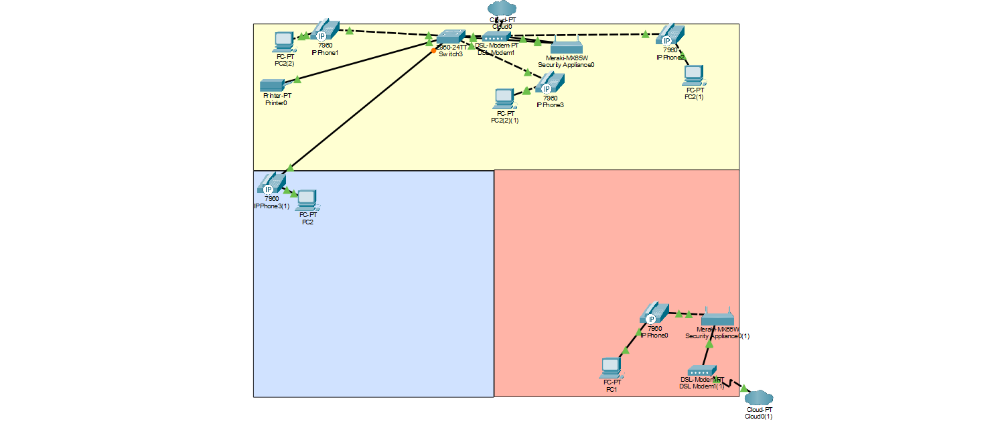
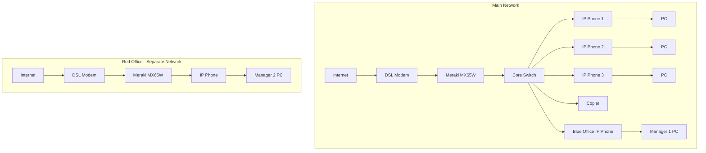
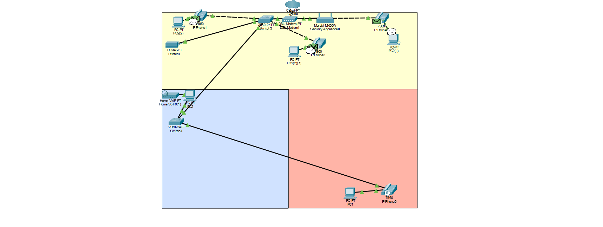
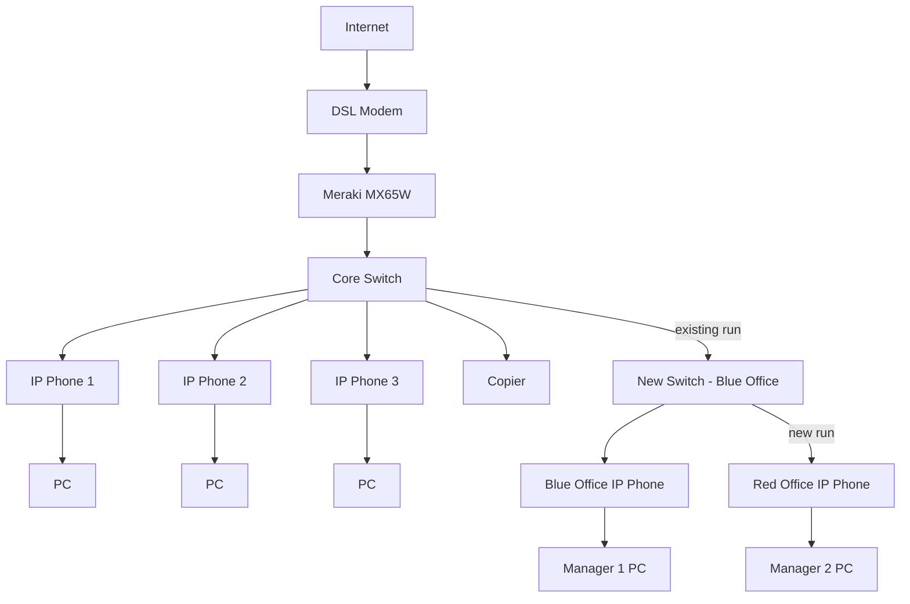

# Office Network Consolidation: Retiring Scan-to-Email and Eliminating a Rogue Network

A real-world small-office project at **Maplecrest Property Group** (fictional name; details sanitized). A security fix exposed a hidden network problem. I resolved it by consolidating a manager's isolated network onto the main office network, which restored device access, put her traffic behind the company firewall, and cut an unnecessary second internet service.

---

## Background: The Security Problem

The office copier was configured for **scan-to-email**, which posed a security risk:

- The copier stored **SMTP credentials** for sending mail, a target if the device is compromised.
- Scans could be sent to **any email address**, creating an easy path for data to leave the organization.
- Sensitive documents (leases, IDs, financial records) were traveling through email instead of staying internal.

**Fix:** We disabled scan-to-email and replaced it with **scan-to-file**, which saves scans to a shared network folder. Documents never leave the internal network.

## The Problem It Revealed

The office has two managers: **Manager 1** in the blue office and **Manager 2** in the red office. After the change, Manager 2 couldn't scan at all. When I investigated, I found her office was running on a **completely separate network** with its own internet service, modem, firewall/router, and switch. It had no connection to the main office network.

Scan-to-email had masked this, because email works over any internet connection. Scan-to-file needs the copier and the PC on the **same network**, so her path to the copier didn't exist.

From a security standpoint, the separate network was also a problem:

- Her traffic **bypassed the main office firewall** and its security policies.
- IT had **no visibility** into a second, unmanaged network.
- It added **extra hardware and a second ISP bill**.

## Before

- **Main office (yellow):** Internet → DSL modem → Meraki MX65W security appliance → Cisco 2960 switch. Three IP phones (with PCs connected through each phone's PC port), the copier, and a long run to Manager 1's office (blue).
- **Manager 2's office (red):** Isolated. Its own internet → DSL modem → Meraki MX65W → IP phone → PC.

## The Solution

Rather than keep paying for and securing a second network, we **cut the separate network completely** and extended the main one. The cost was one new switch and two Ethernet cables.

1. **Uplink:** I took the cable that ran from the core switch to the blue office's IP phone and moved it into the **new switch**.
2. **Blue office (Manager 1):** I ran a new cable from the new switch to her IP phone. Her PC stays connected through the phone's PC port.
3. **Red office (Manager 2):** I ran the second new cable from the new switch into the red office's IP phone. Her PC connects through the phone's PC port, so it's now on the main network.

## After

> In Packet Tracer the new switch is modeled as a 2960. The physical device is a TP-Link TL-SG105 5-port gigabit unmanaged switch.

## Results

- **Scan-to-file works** for both managers. Everyone reaches the copier on one network.
- **One network, one firewall.** All traffic now passes through the main Meraki security appliance.
- **Smaller attack surface.** A second modem, firewall, and ISP connection are gone.
- **Cost savings.** Removed an unnecessary second internet service and hardware for the price of a switch and two cables.

## The Plot Twist

After the cutover, Manager 2's phone in the red office seemed broken. She could call me, but I couldn't call her. One-way calling looked like a VLAN, SIP registration, or cabling problem, so I started troubleshooting the new run.

Turns out the phone was fine. She had **Do Not Disturb** turned on. 😅

**Lesson:** Check the simple stuff first. Before you blame the network, rule out user settings. The OSI model's unofficial Layer 8 (the user) is still a layer.

## Security Takeaways

- **Security changes can expose hidden infrastructure.** Disabling scan-to-email revealed a network nobody was tracking. Asset and network inventory matters.
- **Shadow networks are a risk.** Any connection that bypasses the main firewall bypasses its protections and logging.
- **Keep data internal.** Scan-to-file on the LAN beats sending documents out over email.

## Skills Used

- Network troubleshooting
- Layer 2 switching
- VoIP phone configuration
- Network topology design (Cisco Packet Tracer)
- Cabling
- Network security
- Attack-surface reduction
